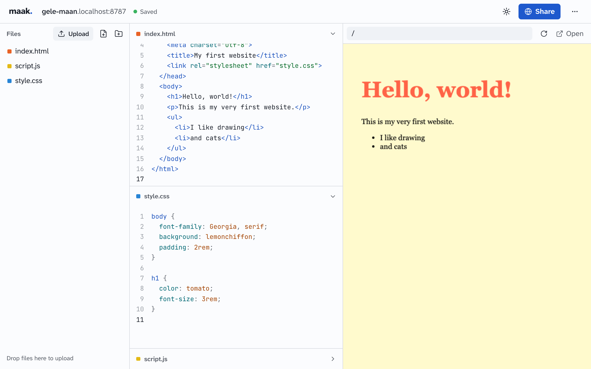

<p align="center">
  <a href="https://maak.io"></a>
</p>

<h1 align="center">maak</h1>

<p align="center"><strong>Build a site without the fight.</strong></p>

<p align="center">
  <a href="https://maak.io">maak.io</a> ·
  <a href="#run-it-locally">Run it locally</a> ·
  <a href="#run-your-own">Run your own</a> ·
  <a href="LICENSE">MIT License</a>
</p>

<br>



maak is a quiet editor in the browser for people who want to learn how a website is made. You write HTML, CSS and JavaScript in real files, the page changes next to the code as you type, and when you share it, it lives at its own address, like `gele-maan.maak.io`.

An AI model can now write a whole site from one sentence. It is still worth knowing what a tag, a stylesheet and a relative path are, so you can read what was made and change it yourself. maak is for learning that. It has no assistant, no templates, no build step and no framework. You get a folder of files, the page they make, and an address to show it to someone. It suits a first lesson in a classroom as well as someone on their own who wants to understand the basics.

The editor has Emmet for HTML, images dragged straight into the code, a console strip under the preview, 30 days of history for every file, a trash, and a ZIP download of a project or of everything you made. The project is a plain folder that works anywhere without maak. The interface is in Dutch and English. The editor loads nothing from other parties, shows no ads, and uses one cookie, to keep you signed in.

## How it works

maak is one Cloudflare Worker, one D1 database and one R2 bucket. Student code is stored and served, never run on the server.

The Worker routes by host name. The editor and its API live on one host. Each shared project is a subdomain of the site suffix, and each project also has a private alias with a secret in its name, which the preview frames. The editor and the student sites can live on one domain or on two; that is configuration (`APP_HOST` and `SITE_SUFFIX`).

A page that hangs in the preview must not freeze the editor. The student sites send `Origin-Agent-Cluster: ?1`, which gives them their own browser process, and "Start preview" moves to a fresh alias host when a page is stuck. The two experiments in [`experiments/`](experiments) measure this in Chrome.

Sign-in is OpenID Connect; maak.io uses Google. An admin page lets a teacher block a project, suspend a person, and close sign-up.

## Run it locally

You need Node.js 22.12 or later.

```bash
npm install
```

```bash
npm run dev
```

Open http://localhost:8787. Sign-in goes to a local provider on port 8788 that accepts any address without a password. `admin@school.test` is the admin. The local database and files are kept in `.wrangler/state`.

## Test

```bash
npx playwright install chromium
```

```bash
npm test
```

This type checks, builds, and runs the Playwright tests: the rules, the API over HTTP, and the editor in Chromium.

## Run your own

The top level of [`wrangler.jsonc`](wrangler.jsonc) is local development. `env.production` is the live maak.io. To run your own copy, replace the values there with yours:

- A Cloudflare account with a zone for your domain, a D1 database and an R2 bucket.
- Routes for the domain and its wildcard, and a proxied wildcard DNS record (`*`) so every subdomain reaches the Worker.
- An OpenID Connect client (for example Google), with the redirect `https://<your host>/auth/callback`.
- The secrets `OIDC_CLIENT_SECRET` and `ADMIN_EMAILS`, set with `npx wrangler secret put <NAME> --env production`.
- Optionally, Cloudflare Email Sending for the address in `MAIL_FROM`, so admins get a mail when someone reports a site.

Then deploy with `npm test && npm run deploy`. The deploy script builds, applies the migrations, deploys, runs a smoke test, and rolls back if the smoke test fails.

The limits per person (5 MB per file, 25 MB per project, 20 projects, 100 MB in all) are in [`src/shared/rules.ts`](src/shared/rules.ts).

## Layout

- `src/worker` the Worker: routing, the API, sign-in, file storage and serving the sites.
- `src/shared/rules.ts` names, paths, content types and limits, shared by the Worker and the editor.
- `web/src` the editor, in Preact and CodeMirror 6.
- `migrations` the D1 schema.
- `scripts` local development, deploy, smoke test, backup and restore.
- `tests` the Playwright tests.

[`AGENTS.md`](AGENTS.md) records the design decisions and the rules that are easy to break.

## License

MIT, see [LICENSE](LICENSE). The fonts (Atkinson Hyperlegible Next, JetBrains Mono) are under the SIL Open Font License and the icons (Lucide) under the ISC License; they come in through npm with their own licence files.
